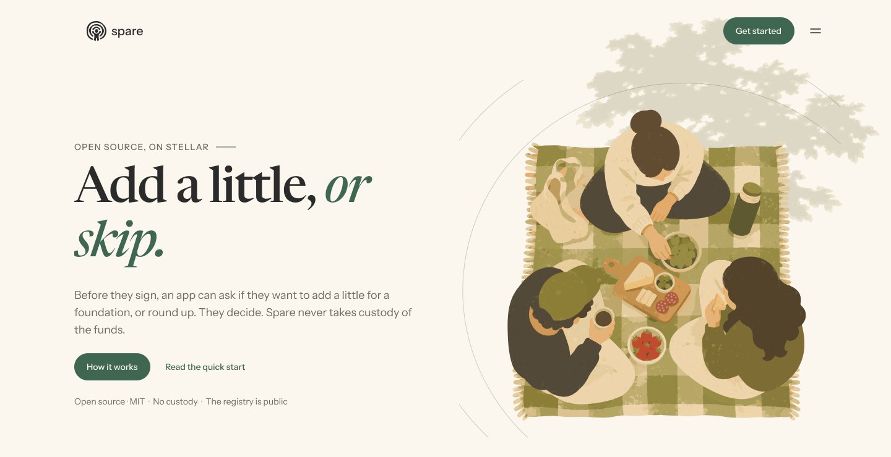
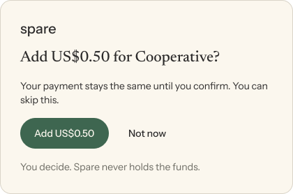

<picture>
  <source media="(prefers-color-scheme: dark)" srcset="docs/assets/hero-dark.png">
  
</picture>

<h1 align="center">spare</h1>

<p align="center">
  <a href="https://www.npmjs.com/package/spare-sdk"></a>
  <a href="https://www.npmjs.com/package/spare-wallets-kit"></a>
  <a href="https://github.com/thesatieofcoding/Spare/actions/workflows/ci.yml"></a>
  <a href="https://www.npmjs.com/package/spare-sdk#provenance"></a>
  <a href="LICENSE"></a>
  <a href="https://donatespare.xyz"></a>
</p>

<p align="center">
  <strong>Add a little, or skip.</strong><br>
  An open-source kit that lets any Stellar app offer a per-transaction USDC donation at signing time.<br>
  The donation goes straight to the foundation. Spare never holds funds and takes no cut.
</p>

<p align="center">
  <a href="#quickstart">Quickstart</a> ·
  <a href="#how-it-works">How it works</a> ·
  <a href="#guarantees">Guarantees</a> ·
  <a href="#packages">Packages</a> ·
  <a href="#development">Development</a>
</p>

---

## Why

At Chilean pharmacies and supermarkets the cashier asks *"¿Dona su vuelto?"* — would you like to donate your change? Small amounts add up to real money for foundations.

On Stellar, fees are low enough to make a US$0.50 donation worth sending, but no package lets an existing app add one at signing time. Today a user who wants to give has to leave the app, find a foundation and send a second payment.

Spare is that missing package. Before the user signs, your app asks **"Add US$0.50 for [foundation]?"** or **"Round up to the next dollar?"**. If they say yes, the donation rides along with their payment.

## How it works

<p align="center">
  
</p>

| Transaction type | What Spare does | Signatures |
| --- | --- | --- |
| **Classic** (payments, path payments, any classic op) | Appends a USDC payment to the foundation **in the same transaction**. Purchase and donation succeed or fail together. | One |
| **Soroban** (`InvokeHostFunction`) | A Soroban tx can hold only one operation, so Spare sends a tagged follow-up payment after the call succeeds. The modal says so before the user accepts. | Two |
| **Ledger** (via Stellar Wallets Kit) | The donation is its own payment operation, so the device shows *"Payment 0.50 USDC to …"* before approval. | One |

Every Spare donation carries the memo `spare:<appId>`, so it is traceable on-chain and attributable to the app that sent it.

**Foundations verify themselves** with a Stellar standard: a foundation registers its account in the Spare registry contract and lists the same account in the `ACCOUNTS` field of its website's `stellar.toml` ([SEP-1](https://github.com/stellar/stellar-protocol/blob/master/ecosystem/sep-0001.md)). Nobody approves it by hand.

## Quickstart

Already signing with Stellar Wallets Kit? Wrap it:

```ts
import { StellarWalletsKit } from "@creit.tech/stellar-wallets-kit";
import { HorizonAccountPort } from "spare-sdk";
import { withSpare } from "spare-wallets-kit";

const network = "testnet"; // "mainnet" in production

const spare = withSpare(StellarWalletsKit, {
  foundation: { account: "G...", domain: "foundation.org" }, // listed in its stellar.toml
  foundationName: "Tellus Cooperative",
  mode: { amount: "0.50" },          // or { roundUp: true } for USDC purchases
  appId: "my-app",                   // memo becomes "spare:my-app"
  maxAmount: "5",                    // your cap per donation
  accounts: new HorizonAccountPort({ network }),
  network,
});

// Drop-in replacement for kit.signTransaction
const { signedTxXdr } = await spare.signTransaction(xdr, { address });
```

Building your own UI? Use [`spare-sdk`](packages/spare-sdk) directly: `addDonation(tx, opts)` for classic transactions and `donateAfter(result, opts)` for Soroban calls.

## Guarantees

- **The user always decides.** Nothing is added without an explicit yes. Declining signs the original transaction, byte for byte.
- **No custody.** Funds go from the user to the foundation in a normal Stellar payment.
- **Circle USDC only** (`GA5ZSEJYB37JRC5AVCIA5MOP4RHTM335X2KGX3IHOJAPP5RE34K4KZVN`). Look-alike assets are rejected.
- **Domain-verified foundations only.** "Domain-verified" means the account is listed on that website's `stellar.toml` — nothing more.
- **Never blocks a payment.** If a check fails (no trustline, low balance, over your cap, unverified foundation) no donation is offered. If anything inside Spare errors, the original transaction is signed.
- **Safe pass-through.** Partly signed, multisig, fee-bump and Soroban transactions are never modified.
- **Private by design.** The public dashboard aggregates by app and foundation and never lists donor addresses.

## Packages

| Package | Description | Status |
| --- | --- | --- |
| [`spare-sdk`](packages/spare-sdk) | Core TypeScript library: classic bundling, Soroban follow-up, eligibility checks, `stellar.toml` verification. | ✅ Built · 77 tests |
| [`spare-wallets-kit`](packages/spare-wallets-kit) | Stellar Wallets Kit wrapper with an accessible confirmation modal (EN/ES, light/dark). | ✅ Built · 37 tests |
| [`contracts/registry`](contracts/registry) | Soroban foundation registry. No admin, no upgrade function, no funds. | ✅ Built · 31 tests · not deployed |
| [`apps/website`](apps/website) | Marketing + docs site (Astro, EN/ES, light/dark). Home and Docs built; Foundations, Dashboard and Demo pending. | 🚧 In progress |
| Indexer | Ingests registry events and tagged USDC payments; rebuildable from Horizon. | 🔜 Planned |
| Dashboard | Public per-foundation pages with totals, apps and transaction links. | 🔜 Planned |
| Demo app | Classic payment + donation and Soroban call + follow-up, on mainnet. | 🔜 Planned |

## Development

Requirements: Node 20+, pnpm 10, Rust (stable) for the contract.

```bash
pnpm install                                   # install workspace
pnpm test                                      # all TypeScript tests
pnpm typecheck                                 # strict type check
pnpm -C packages/spare-sdk exec vitest run test/amount.test.ts   # one file
pnpm -C packages/spare-sdk exec vitest run -t "round-up"         # by test name
cargo test -p spare-registry                   # contract tests
```

```
packages/
  spare-sdk/            core library
  spare-wallets-kit/    Wallets Kit wrapper + confirmation modal
contracts/
  registry/             Soroban foundation registry
docs/assets/            README visuals (exported from the Figma design)
```

## Out of scope

Pooling or splitting donations, choosing or vetting charities, tax receipts, fiat on/off-ramps, and browser extensions that modify other wallets' transactions.

## License

MIT
